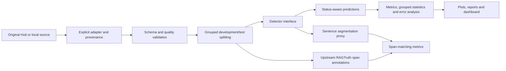

# HalluBench

HalluBench is a reproducible, evidence-relative hallucination detection benchmark for research. It keeps original dataset labels and source evidence, uses group-protected train/validation/test partitions, and ships lexical, semantic, NLI, LLM-judge and supervised detectors. It tests span detection against human RAGTruth hallucination spans and exports status-aware classification metrics, statistical comparisons and interpretable reports.

## Quickstart

```bash
cd hallucination-detection-benchmark
python -m venv .venv
source .venv/bin/activate    # Windows: .venv\Scripts\activate
python -m pip install -e '.[test]'
pytest -q
hallubench validate --prepared tests/fixtures/toy_prepared.jsonl
hallubench run --prepared tests/fixtures/toy_prepared.jsonl --detectors heuristic --output results/fixture-smoke
hallubench report --results results/fixture-smoke
```

`tests/fixtures/toy_prepared.jsonl` holds twelve small, manually authored unit-test fixtures, so scores on them reflect implementation behaviour rather than detection quality.

To run from the source tree instead of installing the package:

```bash
PYTHONPATH=src python -m pytest -q
PYTHONPATH=src python -m hallubench.cli run --prepared tests/fixtures/toy_prepared.jsonl --detectors heuristic --output results/fixture-smoke
PYTHONPATH=src python -m hallubench.cli report --results results/fixture-smoke
```

## Public dataset workflows (network required)

```bash
python -m pip install -e '.[hf,models,test,dashboard]'
# HaluEval's Hub mirror exposes 7 configs; the task pins an explicit revision below.
hallubench inspect --repo pminervini/HaluEval --config qa --split data --revision 72a55d2291cf5f69581e22ac6491b251fc618291
hallubench prepare --source halu --task qa --revision 72a55d2291cf5f69581e22ac6491b251fc618291 --output data/halu_qa.jsonl
hallubench prepare --source halu --task dialogue --revision 72a55d2291cf5f69581e22ac6491b251fc618291 --output data/halu_dialogue.jsonl
hallubench prepare --source halu --task summarization --revision 72a55d2291cf5f69581e22ac6491b251fc618291 --output data/halu_summary.jsonl
hallubench validate --prepared data/halu_qa.jsonl
hallubench tune --prepared data/halu_qa.jsonl --detector heuristic --output results/heuristic_threshold.json
hallubench train --prepared data/halu_qa.jsonl --checkpoint results/qa_logreg.joblib
# Freeze validation-derived thresholds and model revisions in a dedicated config.
hallubench run --prepared data/halu_qa.jsonl --detectors heuristic semantic nli --config configs/detectors.yaml --output results/halu_qa
hallubench report --results results/halu_qa
hallubench compare --results results/halu_qa
streamlit run app/streamlit_app.py
```

`configs/detectors.yaml` ships with preselected defaults rather than tuned hyperparameters. To use validation-selected thresholds, write the saved threshold into the YAML before running the test stage. A classifier must be trained first, and its checkpoint configured, before adding `classifier` to the detector list.

### RAGTruth official release

RAGTruth publishes its official release as a pair of JSONL files on GitHub. Download from the upstream repository, record a Git commit, and store the original files under `data/ragtruth/` (gitignored). Dataset rights are separate from the GitHub code license, so do not publish raw source passages without permission.

```bash
# Run on a machine with network access:
git clone https://github.com/ParticleMedia/RAGTruth.git data/RAGTruth-upstream
git -C data/RAGTruth-upstream rev-parse HEAD  # save this commit in your records
hallubench prepare --source ragtruth --input data/RAGTruth-upstream/dataset/response.jsonl --sources data/RAGTruth-upstream/dataset/source_info.jsonl --output data/ragtruth_prepared.jsonl
hallubench validate --prepared data/ragtruth_prepared.jsonl
hallubench run --prepared data/ragtruth_prepared.jsonl --detectors heuristic nli --config configs/detectors.yaml --output results/ragtruth
hallubench claims --prepared data/ragtruth_prepared.jsonl --detector heuristic --output results/ragtruth/claims_heuristic.jsonl
hallubench report --results results/ragtruth
```

`prepare` preserves RAGTruth's upstream `test` partition and carves validation only from the upstream `train` partition, grouping every output derived from a shared source. When `--revision` is omitted, the input source hash is recorded instead. Some of the original benchmark's fixed split variants contain cross-split duplicates; validation then fails closed rather than reporting a leakage-free claim.

Local CSV/JSONL ingestion requires explicit mappings, never column-name guesswork:

```bash
hallubench prepare --source local --input /path/to/labelled.jsonl --mapping configs/local_mapping_example.yaml --output data/custom_prepared.jsonl
```

For custom HF datasets, specify `--source hf-mapped --repo REPOSITORY --config SUBSET --revision IMMUTABLE_HASH --split train --mapping mapping.yaml --output data/custom.jsonl`. CSV/JSONL files need each record's `source_group` and source-label semantics curated and checked.

## Five evidence-aware detection approaches

| Detector | Implementation | Evidence use | Model download | Meaning of prediction |
| --- | --- | --- | --- | --- |
| `heuristic` | Informative-token recall in supplied evidence | Required | None | Lexical coverage only, not proof |
| `semantic` | MiniLM embeddings + cosine score | Required | Yes | Similarity, not probability |
| `nli` | DeBERTa 3-way entailment/contradiction/neutral | Required | Yes | Relative inference; neutral maps to unsupported, not false |
| `judge` | Explicit provider + JSON factuality rubric | Required | API/model | Structured judgement; abstention supported |
| `classifier` | Train-only TF-IDF + logistic regression | Optional | No | Coarse corpus-specific discriminative signal |

Only observed results are saved. Missing reference evidence becomes an explicit processing status rather than a forced prediction. `insufficient_evidence` gold labels are not force-mapped into the binary hallucination target; a binary positive is `contradicted`, `unsupported` or `partially_supported`. NLI emits three class probabilities and relies on claim segmentation to separate partial support from full support.

## Outputs

Every run writes `experiment.json`, `dataset_quality.json`, `summary.json`, `predictions_*.jsonl`, and `errors_*.jsonl`. The report command writes `findings.md`, `findings.html`, comparison and latency PNGs, per-method confusion matrices and eligible reliability diagrams. `claims` writes predicted sentence spans with source parent and a separate span-IoU analysis; those scores measure span detection rather than atomic-claim recognition.

The Streamlit dashboard reads those saved outputs only and plots nothing that is not in them.

## Architecture



See `docs/` for ontology, study design, dataset source details, annotation workflow, limitations, cost, troubleshooting and a research report outline. The repository does not ship public dataset text, model weights, trained checkpoints or predictions presented as public-dataset results. A GitHub Actions workflow (`.github/workflows/ci.yml`) runs the deterministic tests and a fixture-only smoke evaluation on pushes and pull requests.
