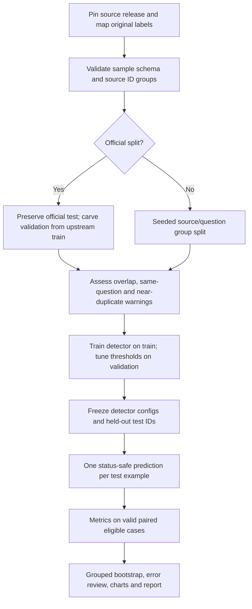

# Evaluation and leakage-resistant experimental workflow



* **Protection:** all responses from one source/parent are assigned together. Identical source group keys, long exact evidence sources, non-generic normalized questions and exact long answers across splits are checked; char 3–5 gram near-duplicates (cosine distance 0.03 or less) checked for corpora of <=3,000 rows. Large-corpus exhaustive near-duplicate auditing is not part of the current implementation, so perform scalable fuzzy-dedup auditing separately before claiming comprehensive cross-split leakage protection.
* HaluEval has one `data` split: derived deterministic seed-17 70/15/15 partitions by original pair/source, with no attempt to treat machine-constructed alternative answers as independent samples.
* RAGTruth has upstream `train` and `test`: preserve test; choose validation via a group-deterministic ~15/85 carve-out of upstream train; annotate this newly derived validation split separately from the upstream train/test split kept in the raw record.
* **Test-only once:** Thresholds/hyperparameters selected by validation; do not use test to optimize. Training and validation require disjoint source groups. `--max-examples` selects sorted held-out IDs for a smoke evaluation, not a random unbiased subsample.
* **Eligibility:** Each detector receives identical test examples. Evidence requiring detectors get explicit `missing_evidence` statuses when needed. Accuracy/F1 are computed only on successful eligible predictions, with coverage denominators shown. Paired comparisons use the common successfully evaluated subset.
* **Macro-F1/weighted-F1**, binary hallucination precision/recall/F1, balanced accuracy, MCC, labels-fixed confusion matrix are saved. ROC/PR AUC, Brier, ECE and reliability diagrams require real model-produced class probabilities for the complete class set and both ground-truth classes; **not calculated on raw lexical or cosine scores**.
* **Abstention**: coverage and per-status counts always reported. Selective risk-vs-coverage experiments can be produced by stratifying saved scores, but do not claim coverage improvement without validation and test experiment.
* **Claims**: apply sentence segmentation to each response, run same detector separately on each sentence, align predicted error sentences with RAGTruth annotated spans via one-to-one greedy char-IoU >= 0.5. Precision/recall/F1 are *span localization* scores. Detection is not evaluated as an atomic verified claim classifier; boundary mismatches can cause underestimates.
* **Task effects**: Evaluate QA/dialogue/summarization on separate HaluEval configs; RAGTruth QA, Summary, Data2txt separate by recorded `task`. By-dataset/task/generator tables are exported. Check parent-group dependence before significance analysis.
* **Interpretation:** A false negative is an annotated hallucination missed by the detector; a false positive is an evidentially supported reference marked hallucinated. Both are clinically different measurement errors in the context of factuality auditing; “unsupported” is not proven false.

## Minimal canonical JSON example (field shape only)

```json
{
  "example_id": "dataset:row:response", "question": "original prompt",
  "evidence": "reference context or null", "reference_answer": null,
  "answer": "model output", "original_label": "upstream label",
  "label": "insufficient_evidence", "dataset": "upstream name",
  "revision": "immutable revision or sha256", "task": "qa",
  "group_id": "shared-source-key", "source_id": "original source key",
  "generator": null, "split": "test", "provenance": "human/curated/upstream",
  "annotations": [], "confidence": null, "original": {}
}
```
